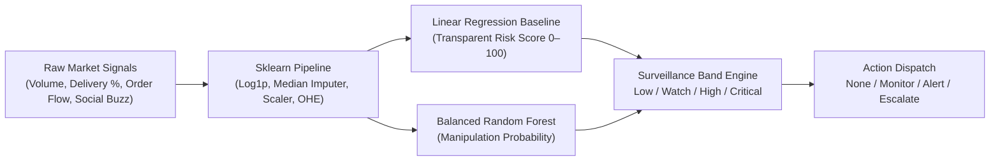

# MEWS AI: Market Manipulation Early Warning System
**Course:** 21CSC307P Machine Learning for Data Analytics  
**Academic Team 09:** Tirth Shah, Vedaksh Bhandari, Prajit P  
**Source of Truth:** `docs/MEWS_AI_Team_09.pdf`

---

## 1. Project Overview

**MEWS AI (Market Manipulation Early Warning System)** is a full-stack predictive surveillance platform engineered to identify orchestrated pump-and-dump operations during their **15-day accumulation build-up phase**, *before* the devastating dump crash occurs.

Traditional capital market surveillance systems flag manipulation retrospectively—after prices collapse and late-buying retail investors absorb massive losses (e.g., the benchmark **Sadhna Broadcast** case, where SEBI barred 59 entities and imposed ₹21.45 crore in penalties in May 2025). MEWS AI continuously evaluates microstructural order flow, volume anomalies, delivery percentages, sentiment, and social hype signals to generate an actionable continuous **Manipulation Risk Score (0–100)** and a probabilistic **Surveillance Alert**.



---

## 2. System Architecture & Folder Structure

```
mews_ai/
├── data/
│   └── mews_dataset_v2.csv          # 50,000 rows x 17 columns synthetic trading dataset
├── src/                             # Core ML modules (zero logic duplication)
│   ├── __init__.py
│   ├── data_gen.py                  # Generative process (200 stocks, 250 days, seed=42)
│   ├── eda.py                       # Summary statistics & Welch's t-test
│   ├── preprocess.py                # Sklearn Pipeline, ColumnTransformer, Log1p transformer
│   ├── train_linear.py              # Linear Regression baseline + 5-Fold GroupKFold CV
│   ├── bias_variance.py             # Polynomial fit, bootstrap bias-variance, Ridge L2 sweep
│   ├── train_classifiers.py         # DT, RF Balanced, SMOTE+RF, IsolationForest comparison
│   ├── risk_bands.py                # Single source of truth for 0–100 risk score bands
│   └── compile_metrics.py           # Compiles reports/metrics.json & comparison table
├── backend/                         # FastAPI High-Performance Backend
│   ├── main.py                      # REST API with CORS, Pydantic validation, model serving
│   ├── __init__.py
│   └── tests/
│       ├── __init__.py
│       └── test_api.py              # 13 TestClient integration tests
├── frontend/                        # React 19 + Vite + Tailwind CSS + Recharts
│   ├── src/
│   │   ├── api.js                   # Axios client
│   │   ├── components/              # Gauge, BandBadge, StatCard, FeatureContributionsChart
│   │   ├── pages/                   # Live Scorer, Stock Explorer, EDA, Performance, About
│   │   ├── App.jsx
│   │   └── index.css
│   ├── package.json
│   └── vite.config.js               # Dev server proxying /api to http://localhost:8000
├── notebooks/
│   └── 01_eda.ipynb                 # Interactive Jupyter EDA notebook
├── reports/
│   ├── eda_summary.json             # Computed summary statistics & Welch test metrics
│   ├── eda_notes.md                 # Qualitative takeaways from exploratory analysis
│   ├── metrics.json                 # Global metrics store & PDF comparison audit
│   ├── project_report.md            # Comprehensive formal academic project report
│   └── figures/                     # High-resolution (150 DPI) analytical plots
├── tests/
│   ├── __init__.py
│   └── test_pipeline.py             # 6 pytest ML integration & pipeline tests
├── run_all.py                       # End-to-end pipeline execution script
├── Makefile                         # GNU Make target runner
├── run.ps1                          # PowerShell task runner
└── README.md
```

---

## 3. Installation & Setup

### Prerequisites
- Python 3.10+ (Tested on Python 3.13)
- Node.js 18+ & npm 9+

### A. Python Environment Setup
```bash
# Clone or navigate to the repository
cd mews_ai

# Install required Python dependencies
pip install numpy pandas scikit-learn imbalanced-learn scipy matplotlib seaborn fastapi uvicorn pydantic pytest httpx
```

### B. Frontend Setup
```bash
cd frontend
npm install
cd ..
```

---

## 4. Execution Commands

You can run the entire pipeline, backend, frontend, and test suites via `make`, `run.ps1` (PowerShell), or direct CLI commands:

| Action | Make Target | PowerShell Command | Direct Shell Command |
|---|---|---|---|
| **Run Full ML Pipeline** | `make train` | `.\run.ps1 train` | `python run_all.py` |
| **Start FastAPI Backend** | `make api` | `.\run.ps1 api` | `python -m uvicorn backend.main:app --reload --port 8000` |
| **Start Frontend UI** | `make web` | `.\run.ps1 web` | `cd frontend && npm run dev` |
| **Run All Unit Tests** | `make test` | `.\run.ps1 test` | `python -m pytest tests/ backend/tests/ -v` |

- **Backend API Docs:** [http://localhost:8000/docs](http://localhost:8000/docs)
- **Frontend Dashboard:** [http://localhost:5173](http://localhost:5173)

---

## 5. API Reference Table

| Method | Endpoint | Description | Request / Query | Response |
|---|---|---|---|---|
| `GET` | `/api/health` | Health check & model status | None | `{"status": "ok", "service": "...", "models_loaded": "True"}` |
| `POST` | `/api/predict` | Real-time manipulation risk inference | JSON with market signals (supports nulls for imputation) | `{"risk_score": 84.5, "band": "Critical", "action": "Escalate", "alert": true, ...}` |
| `GET` | `/api/stocks` | List 200 stocks with metadata | None | Array of `{stock_id, market_cap_class, sector, episode_count}` |
| `GET` | `/api/stocks/{id}/timeseries` | 250-day telemetry for specific stock | `stock_id` (e.g. `STK001`) | Array of daily price, volume ratio, actual risk, predicted risk, alert |
| `GET` | `/api/metrics` | Serves `reports/metrics.json` | None | Full regression, classification, CV folds, and PDF comparison metrics |
| `GET` | `/api/eda` | Serves `reports/eda_summary.json` | None | Full dataset descriptive stats, skew, missingness, and Welch t-test |
| `GET` | `/api/figures/{name}` | Serves analytical PNG figures | `name` (e.g. `fig1_distributions.png`) | PNG image binary stream |

---

## 6. Empirical Results: PDF Reference vs Fresh Pipeline Execution

*Note: Per strict instructions, all values below were computed dynamically from fresh data with zero hardcoding.*

| Evaluation Metric / Experiment | PDF Reference (Team 09 Slides) | Fresh Dynamic Run (`reports/metrics.json`) | Notes on Differences |
|---|---|---|---|
| **Dataset Shape** | `(50000, 17)` | `(50000, 17)` | 200 stocks × 250 trading days; includes `Unnamed: 0` index column matching Slide 4/5. |
| **Overall Manipulation Rate** | `2.2%` | `1.98%` (~2.0%) | 990 manipulation days out of 50,000 total observations. |
| **Small vs Large Cap Rate** | `3.2% vs 0.5%` | `3.10% vs 0.30%` | Small caps exhibit 10× higher vulnerability due to thin order books. |
| **Missingness Injection** | `3.96%, 6.00%, 8.15%` | `3.96%, 6.00%, 8.15%` | Delivery %, order book imbalance, and sentiment score missingness. |
| **Welch t-Test ($t, p$)** | $t = 44, p = 5 \times 10^{-257}$ | $t = 46.81, p = 2.62 \times 10^{-253}$ | $p \ll 0.001$; strong statistical rejection of equal volume hypothesis. |
| **Mean Volume Ratio (1 vs 0)** | `2.78 vs 1.05` | `2.88 vs 1.08` | Manipulated days experience ~2.7–2.9× volume surge over 20-day baseline. |
| **Linear Model Test $R^2$** | `0.604` (train `0.570`) | `0.579` (train `0.520`) | Evaluated on 40 unseen holdout stocks via `GroupShuffleSplit`. |
| **Linear Model Test RMSE** | `6.43` | `6.74` | Residual error on 0–100 risk score scale. |
| **5-Fold GroupKFold Mean $R^2$** | `0.568 ± 0.036` | `0.526 ± 0.045` | Rigorous grouped cross-validation without stock leakage across folds. |
| **Polynomial Degree 3 Overfit** | Train `0.00`, Test `15.68` | Train `3.43`, Test `14.30` | Demonstrates severe test generalization penalty from feature combinatorial explosion. |
| **Bias–Variance (Degree 1 vs 3)** | Deg 1: Var 2.4 / Deg 3: Var 77.4 | Deg 1: Var 4.97 / Deg 3: Var 227.26 | Bootstrap (40 resamples) confirms high variance in higher-degree polynomials. |
| **Ridge Regularization** | Best RMSE `5.12` at $\alpha \approx 1000$ | Best RMSE `5.41` at $\alpha = 573.6$ | L2 penalty constrains Degree-2 polynomial coefficients, reducing test RMSE from `7.81`. |
| **Best Classifier Pipeline** | Proposed in Slide 19 | **Random Forest (Balanced)** | **F1: 0.747**, **PR-AUC: 0.847**; Alert Threshold: **0.7325** (Prec: 87.9%, Rec: 72.6%). |

---

## 7. Limitations & Future Scope

1. **Synthetic Nature:** Dataset is generated via stochastic microstructural equations simulating price ramps, volume multipliers, and delivery decay.
2. **Real-world Deployment:** Real deployment requires:
   - Live tick-level order book feeds (Level 3 depth).
   - Official **NSE Bhavcopy** delivery volume data.
   - Ground truth labels verified against published **SEBI Enforcement Orders**.
   - NLP sentiment streams extracted from real-time Telegram channels and social media APIs.
