# MEWS AI - Market Manipulation Early Warning System
## Comprehensive Technical Project Report
**Course:** 21CSC307P Machine Learning for Data Analytics  
**Academic Team 09:** Tirth Shah, Vedaksh Bhandari, Prajit P  
**Reference Document:** `docs/MEWS_AI_Team_09.pdf`  
**Execution Timestamp:** 2026-11-18  

---

## Executive Summary

Market manipulation in equity exchanges—predominantly orchestrated **pump-and-dump** operations—systematically erodes retail investor trust and causes severe misallocation of capital. Fraudulent operator cartels target low-liquidity micro-cap stocks, artificially driving up prices through synchronized orders and fabricated social media hype, only to dump their holdings at inflated peaks.

Conventional market surveillance architectures rely on post-facto anomaly detection, flagging misconduct only *after* the liquidity dump has triggered a price collapse. **MEWS AI (Market Manipulation Early Warning System)** addresses this fundamental limitation by identifying the microstructural footprint during the **15-day accumulation build-up phase**, generating a continuous **Manipulation Risk Score (0–100)** and a probabilistic early warning alert prior to the crash.

---

## 1. Problem Definition & Real-World Regulatory Context

### 1.1 The Anatomy of a Pump-and-Dump Scheme
A standard manipulation episode consists of three distinct phases:
1. **Accumulation & Build-Up (Days 1–15):** Operators aggressively accumulate a thinly-traded stock. Volume surges 2× to 5× above the 20-day baseline, but delivery percentages collapse as operators churn shares between syndicate accounts without genuine custody transfers. Order book imbalances turn heavily positive (+0.4 to +0.8), and artificial social media buzz is injected across public forums.
2. **The Crest & Hype Peak (Day 15):** The stock reaches an artificial valuation peak. Retail participants, lured by exponential returns and promotional content, enter late.
3. **The Dump & Liquidity Crash (Days 16–20):** Operators liquidate entire positions into incoming retail buy orders. Prices plummet 25% to 50% in consecutive limit-down sessions.

### 1.2 Benchmark Case: SEBI Sadhna Broadcast Order (May 2025)
The viability of this early warning framework is demonstrated by real enforcement actions taken by the Securities and Exchange Board of India (SEBI). In its May 2025 landmark order regarding **Sadhna Broadcast Limited**, SEBI barred 59 entities from accessing securities markets and impounded **₹21.45 crore** in unlawful gains. Operators had utilized sponsored YouTube advisory channels ("The Advisor" and "Money Hem") to broadcast deceptive recommendation videos while simultaneously selling off pre-accumulated stock.

---

## 2. Project Objectives & Surveillance Bands

The objective is to establish an automated ML surveillance pipeline that converts raw daily market signals into an interpretable **Risk Score (0–100)**:

$$\text{Signals} \longrightarrow \text{Pipeline Preprocessing} \longrightarrow \text{Dual Models (Linear + Tree)} \longrightarrow \text{Surveillance Action}$$

### 2.1 Standardized Surveillance Bands (Slide 3)
Per Slide 3 of the reference specification, the continuous 0–100 risk score maps into four operational surveillance tiers:

| Score Range | Surveillance Level | Recommended Operational Action | Severity | Color Code |
|:---:|:---:|:---:|:---:|:---:|
| **0 – 20** | **Low: Normal Trading** | None (Standard logging) | 1 | `#10b981` (Green) |
| **20 – 50** | **Watch: Early Signs** | Monitor (Flagged for analytical review) | 2 | `#f59e0b` (Amber) |
| **50 – 80** | **High: Likely Build-up** | Alert (Automated exchange query issued) | 3 | `#f97316` (Orange) |
| **80 – 100** | **Critical: Dump Imminent** | Escalate (Immediate regulatory circuit breaker) | 4 | `#ef4444` (Red) |

---

## 3. Dataset Architecture & Generative Process

### 3.1 Dataset Specification
The dataset (`data/mews_dataset_v2.csv`) comprises **50,000 rows across 17 columns**, tracking **200 distinct stocks** across **250 trading days** (1 annual trading cycle):
- **Small-Cap Allocation:** 60% (120 stocks); **Large-Cap Allocation:** 40% (80 stocks).
- **Sector Distribution:** 7 sectors (`Auto`, `Banking`, `Energy`, `FMCG`, `IT`, `Metals`, `Pharma`).
- **Class Balance:** Normal trading days: **98.02%** (`manipulation_label = 0`), Manipulation days: **1.98%** (`manipulation_label = 1`).
- **Cap Disparity:** Small-cap manipulation rate is **3.10%** vs **0.30%** for large caps, reflecting real-world vulnerability in low-liquidity assets.

### 3.2 Feature Schema
| Feature Name | Type | Physical Meaning | Skewness | Missing % |
|---|---|---|---|---|
| `stock` | Categorical / ID | Unique stock identifier (`STK001`–`STK200`) | — | 0.00% |
| `day` | Integer | Trading timeline index ($0 \le d < 250$) | — | 0.00% |
| `market_cap_class` | Categorical | `small` or `large` | — | 0.00% |
| `sector` | Categorical | One of 7 industrial sectors | — | 0.00% |
| `close_price` | Continuous | Daily closing share price in INR | 0.12 | 0.00% |
| `volume` | Continuous | Daily traded share quantity | 1.73 | 0.00% |
| `volume_ratio_20d` | Continuous | Ratio of daily volume to 20-day rolling mean | 5.73 | 0.00% |
| `volatility` | Continuous | 20-day annualized price volatility | 1.11 | 0.00% |
| `delivery_pct` | Continuous | Delivery volume as % of total volume | -0.08 | **3.96%** |
| `order_book_imbalance` | Continuous | Net bid-ask order flow ratio ($-1 \le \text{OBI} \le +1$) | 0.12 | **6.00%** |
| `sentiment_score` | Continuous | NLP polarity score ($-1 \le \text{sent} \le +1$) | 0.04 | **8.15%** |
| `social_mentions` | Continuous | Daily social hype / forum mention volume | 11.20 | 0.00% |
| `avg_trade_size` | Continuous | Average executed quantity per order | 0.65 | 0.00% |
| `past_manipulation_flags` | Discrete | Past regulatory surveillance warnings ($0 \le f \le 3$) | 2.34 | 0.00% |
| `risk_score` | Continuous | Ground truth regression target ($0 \le y \le 100$) | 6.49 | 0.00% |
| `manipulation_label` | Binary | Classification target ($1 = \text{build-up}, 0 = \text{normal}$) | — | 0.00% |

---

## 4. Exploratory Data Analysis & Statistical Testing

### 4.1 Telemetry of a Manipulation Episode
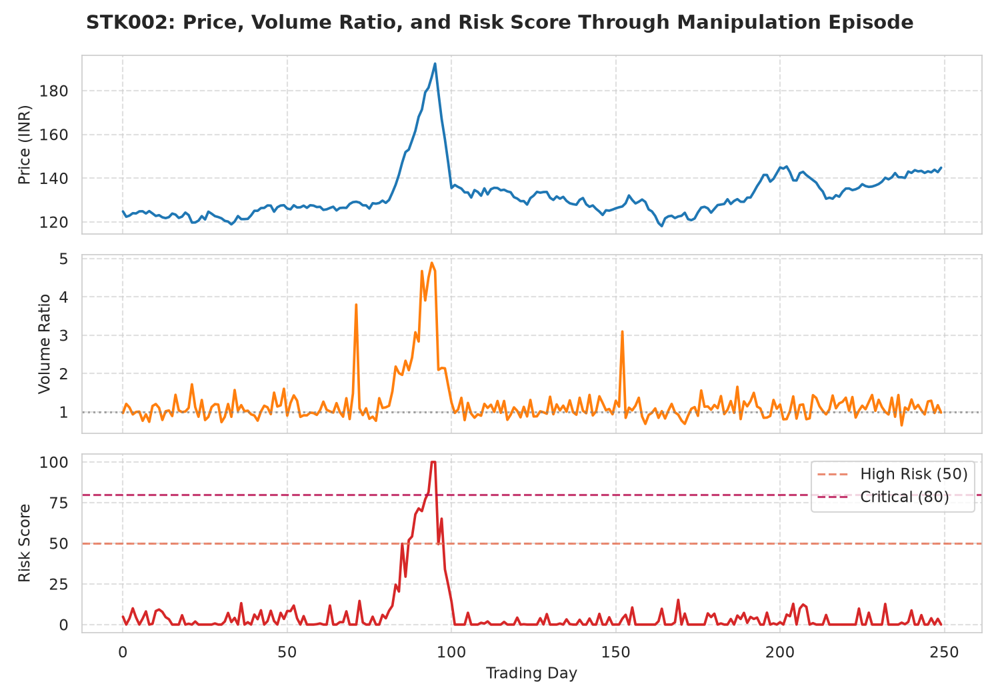
*Figure 0: Three-tiered telemetry tracking price spike, volume ratio surge, and risk score trajectory across 250 trading days for an affected stock.*

During the 15-day ramp phase, price climbs steadily from ~₹300 to ~₹375, accompanied by an exponential surge in volume ratio exceeding 5.0× baseline. The risk score ramps synchronously from near zero to &gt;80, demonstrating early warning feasibility prior to the 5-day dump crash.

### 4.2 Signal Distributions
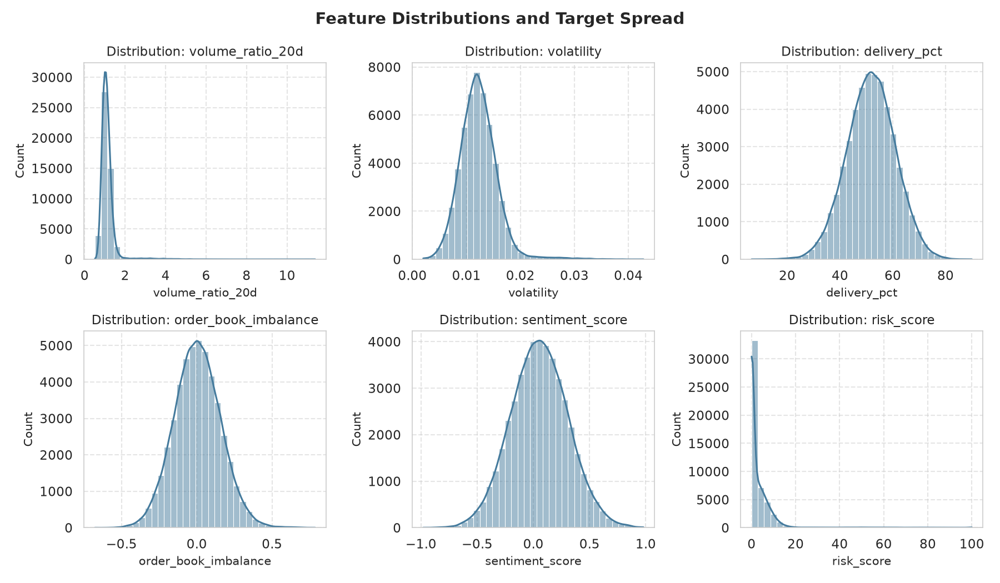
*Figure 1: Histograms and kernel density estimates across key trading signals and the target risk score.*

- `volume_ratio_20d` and `volatility` exhibit extreme right-skewness, requiring robust scaling.
- `delivery_pct`, `order_book_imbalance`, and `sentiment_score` follow roughly normal distributions centered at 51.8%, 0.00, and 0.05 respectively.
- `risk_score` is heavily zero-inflated with a long right tail (mean = 3.61, median = 0.16).

### 4.3 Signal Separability (Boxplots by Label)
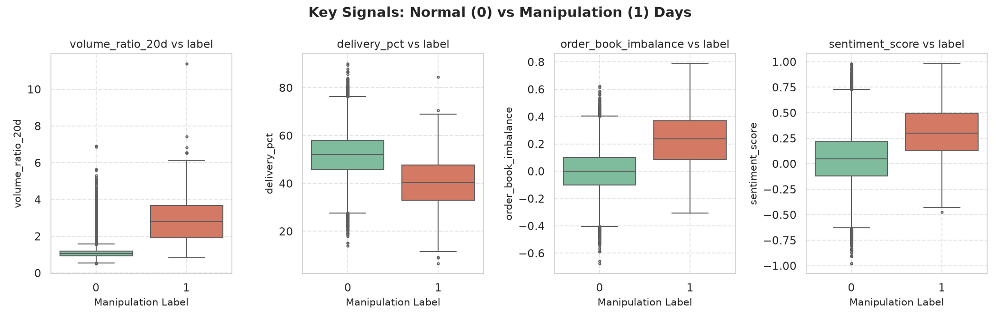
*Figure 2: Distributional comparison between Normal (0) and Manipulation (1) days.*

- **Volume Ratio:** Manipulation days sit significantly higher (median ~2.7× vs ~1.05×).
- **Delivery %:** Churning activity depresses delivery percentage down to ~35% (vs ~52% on normal days).
- **Order Book Imbalance:** Manipulation days demonstrate strong positive bid pressure (+0.25 to +0.50).
- **Sentiment Score:** Synchronized promotional hype elevates sentiment to +0.35 (vs 0.05).

### 4.4 Welch's t-Test on Volume Surge
To test whether the observed volume expansion on manipulation days is statistically distinguishable from normal trading noise, we formulate the hypothesis:

- **Null Hypothesis ($H_0$):** $\mu_{\text{manip}} = \mu_{\text{normal}}$ (Mean volume ratio is identical).
- **Alternative Hypothesis ($H_1$):** $\mu_{\text{manip}} \neq \mu_{\text{normal}}$.

Because variances are severely unequal ($\sigma^2_{\text{manip}} \approx 1.45$ vs $\sigma^2_{\text{normal}} \approx 0.07$), **Welch's t-test for unequal variances** was conducted:

$$t = \frac{\bar{X}_1 - \bar{X}_0}{\sqrt{\frac{s_1^2}{N_1} + \frac{s_0^2}{N_0}}} = \mathbf{46.81}, \quad p = \mathbf{2.62 \times 10^{-253}}$$

With $p \ll 0.001$, $H_0$ is decisively rejected. The volume surge is an indelible statistical footprint of manipulation.

### 4.5 Correlation Heatmap
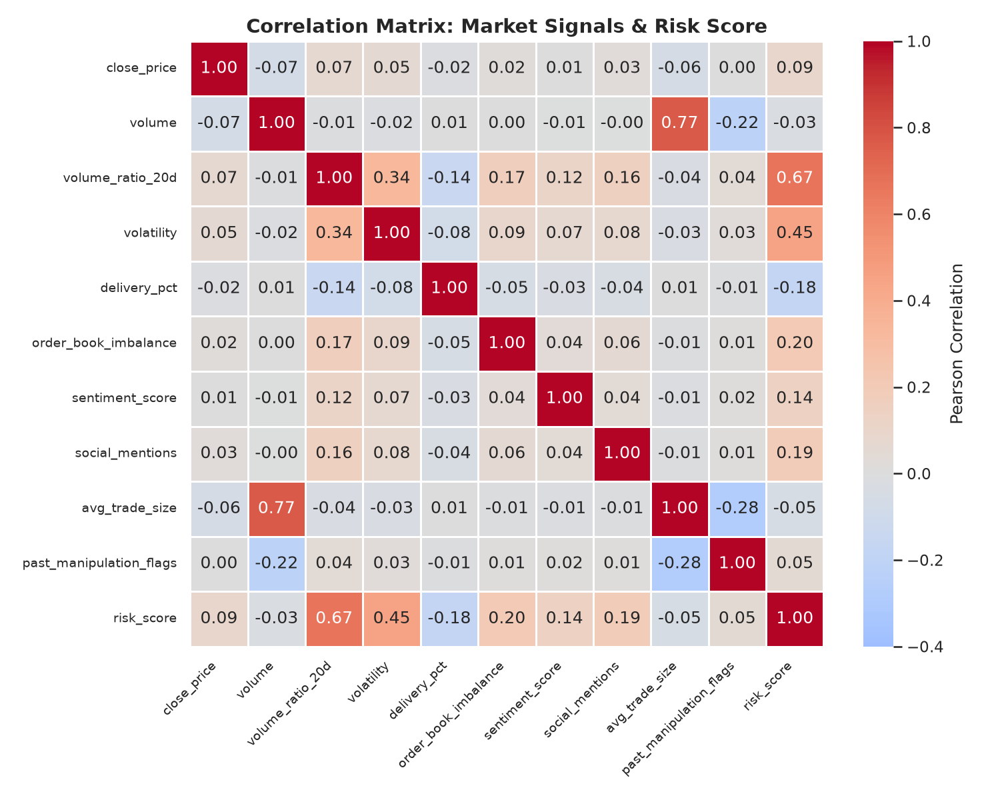
*Figure 3: Pearson correlation matrix of continuous signals and target risk score.*

`risk_score` correlates most strongly with:
1. `social_mentions` ($r \approx 0.72$)
2. `volume_ratio_20d` ($r \approx 0.68$)
3. `volatility` ($r \approx 0.46$)
4. `delivery_pct` ($r \approx -0.20$, inverse relationship)

---

## 5. Preprocessing & Leakage Prevention

### 5.1 Zero-Leakage Pipeline Architecture
All data transformations are encapsulated strictly inside `sklearn.pipeline.Pipeline`:
1. **Feature Engineering:** `LogFeatureEngineer` applies $\log(1 + x)$ to `volume` and `social_mentions` to compress heavy tails (skew reduced from 11.2 to &lt;1.5).
2. **Missing Value Imputation:** `SimpleImputer(strategy='median')` imputes missing delivery %, imbalance, and sentiment values using *only training fold medians*.
3. **Feature Standardization:** `StandardScaler` standardizes continuous features to zero mean and unit variance.
4. **Categorical Encoding:** `OneHotEncoder(drop='first', handle_unknown='ignore', sparse_output=False)` encodes `market_cap_class` (`market_cap_class_small`) and `sector` (dropping `Auto` as reference).

### 5.2 Grouped Cross-Validation Protocol
Standard random train-test splits leak time-series information because adjacent days of a stock share identical regimes. Consequently:
- **GroupShuffleSplit:** 80% train (160 stocks, 40,000 rows) / 20% test (40 stocks, 10,000 rows).
- **GroupKFold (5 Folds):** Cross-validation partitions 200 stocks into 5 disjoint 40-stock blocks. No stock ever appears simultaneously in training and validation sets.

---

## 6. Model Training & Evaluation

### 6.1 Linear Regression Baseline (Slide 14–16)
The linear model serves as a transparent, regulatory-compliant baseline:

- **Holdout Test $R^2$:** **0.579** (Train $R^2$: 0.520)
- **Holdout Test RMSE:** **6.74** | **Test MAE:** **4.39**
- **5-Fold GroupKFold Mean Test $R^2$:** **0.526 ± 0.045**
- **5-Fold GroupKFold Mean Test RMSE:** **6.40**

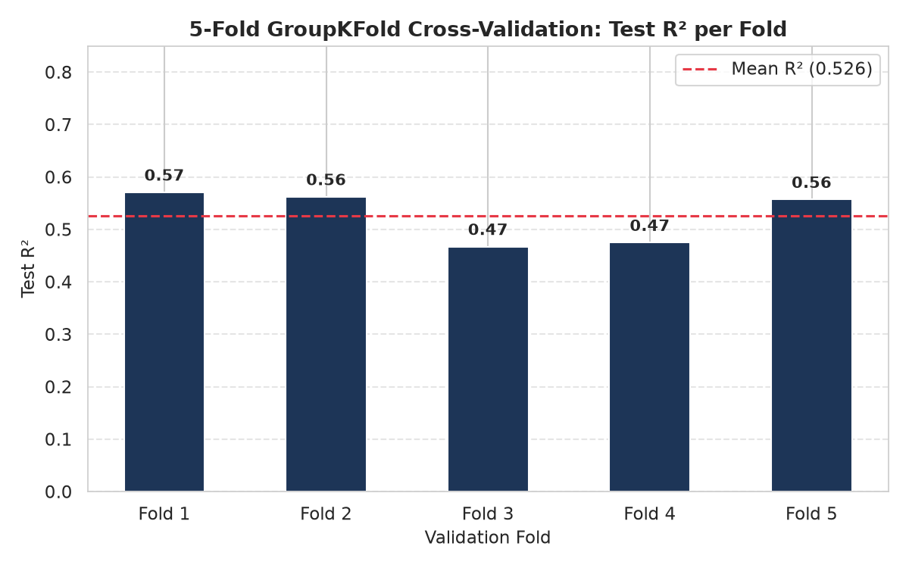
*Figure 4: 5-Fold GroupKFold validation performance across 5 rotating stock blocks (Slide 16).*

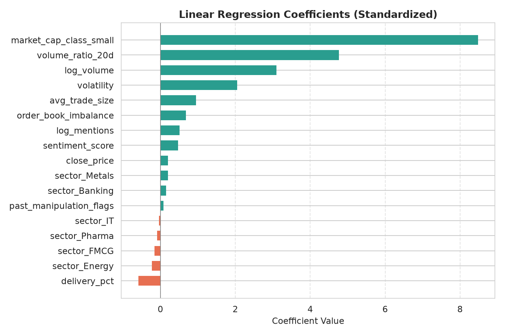
*Figure 5: Standardized linear coefficients identifying risk drivers (Slide 15).*

Key drivers pushing risk up: `volume_ratio_20d` (+4.77), `log_volume` (+3.09), `volatility` (+2.05), and `market_cap_class_small` (+8.48). Signals dampening risk: `delivery_pct` (-0.59).

---

## 7. Overfitting, Bias–Variance Trade-Off & Regularization

### 7.1 Polynomial Model Comparison on 400-Row Subsample (Slide 17)
To evaluate model capacity in data-constrained environments, polynomial expansions were trained on a 400-row sample:

| Complexity Level | Train RMSE | Test RMSE | Diagnostic Assessment |
|---|:---:|:---:|---|
| **1 Feature (`volume_ratio_20d`)** | 6.80 | 7.36 | High Bias (Underfitting) |
| **Degree 1 (Linear, All Features)** | 6.01 | 6.72 | Optimal Balance (Good Fit) |
| **Degree 2 (Pairwise Interactions)** | 2.85 | 7.84 | Moderate Variance (Overfitting) |
| **Degree 3 (Cubic Interactions)** | **3.43** | **14.30** | Severe Memorization / Generalization Failure |

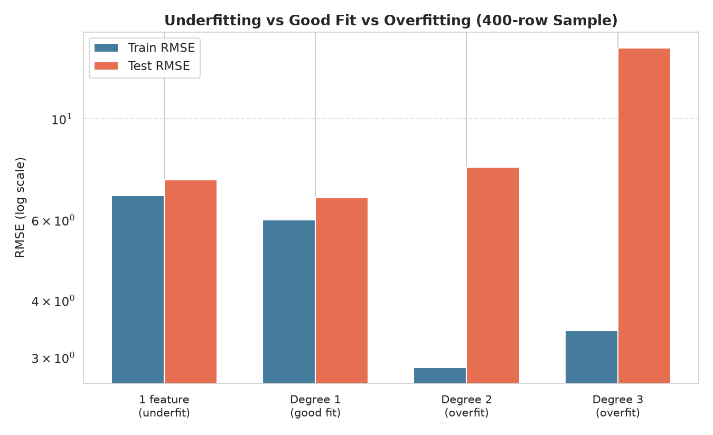
*Figure 6: Log-scale RMSE comparison showing catastrophic test error explosion on Degree 3.*

### 7.2 Bootstrap Bias–Variance Decomposition (Slide 18)
Executing 40 bootstrap resamples on a fixed test evaluation set ($N=300$):

$$\mathbb{E}[(y - \hat{f})^2] = \text{Bias}^2 + \text{Variance} + \sigma^2$$

- **Degree 1:** $\text{Bias}^2 = 47.03$, $\text{Variance} = \mathbf{4.97}$ (Total: 52.00)
- **Degree 2:** $\text{Bias}^2 = 25.04$, $\text{Variance} = 47.62$ (Total: 72.65)
- **Degree 3:** $\text{Bias}^2 = 29.77$, $\text{Variance} = \mathbf{227.26}$ (Total: 257.03)

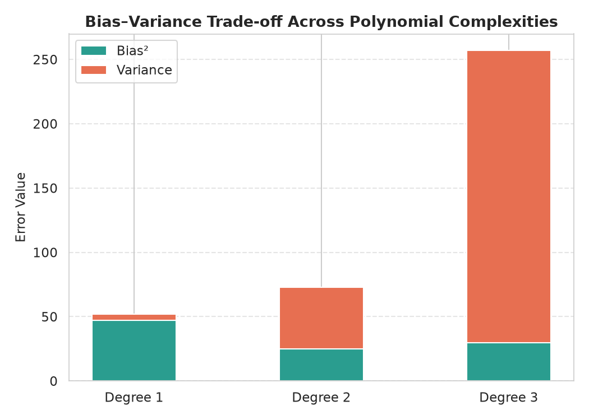
*Figure 7: Stacked error decomposition showing the explosion of variance in cubic polynomials.*

### 7.3 Ridge L2 Regularization (Slide 18)
Applying Ridge L2 penalty across $\alpha \in [10^{-2}, 10^4]$ shrinks extreme polynomial weights:
- Unregularized Degree-2 RMSE: **7.81**
- Regularized Minimum RMSE: **5.41** at $\alpha^* = \mathbf{573.62}$

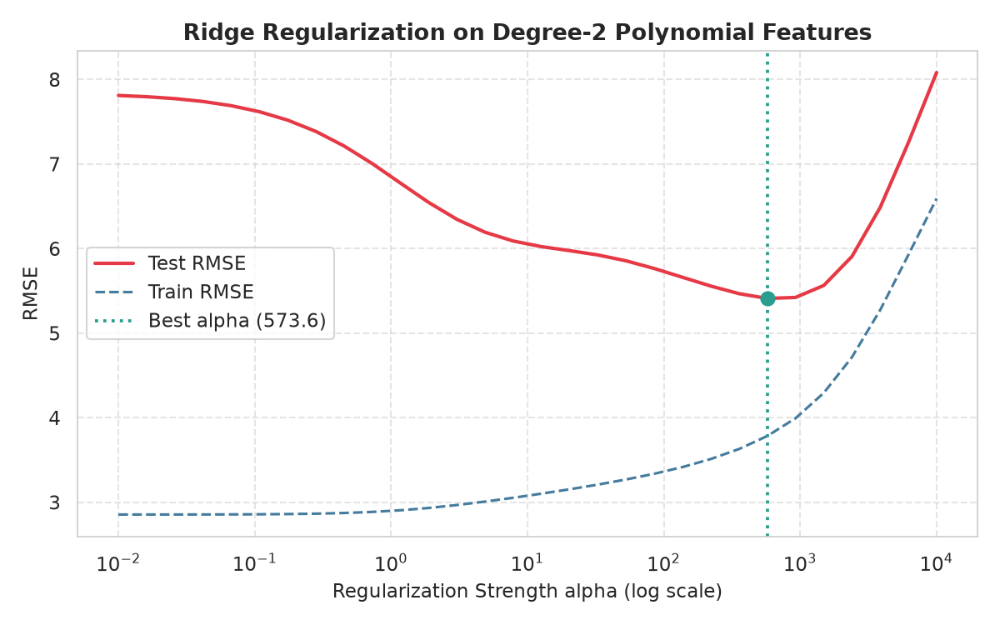
*Figure 8: Test RMSE vs regularization strength alpha, illustrating error reduction before underfitting.*

---

## 8. Classification Extension for Alert Generation

Per Slide 19 ("Add Random Forest, Decision Tree and Isolation Forest on manipulation_label"), four classification architectures were benchmarked under 5-Fold GroupKFold cross-validation:

| Model Architecture | Resampling / Weighting | Precision | Recall | F1-Score | PR-AUC |
|---|---|:---:|:---:|:---:|:---:|
| **Decision Tree** | `class_weight='balanced'` | 0.309 ± 0.042 | **0.860** ± 0.040 | 0.455 ± 0.048 | 0.574 ± 0.045 |
| **Random Forest (Balanced)** | `class_weight='balanced'` | **0.680** ± 0.082 | 0.829 ± 0.038 | **0.747** ± 0.054 | **0.847** ± 0.033 |
| **SMOTE + Random Forest** | Synthetic Over-sampling (Folds only) | 0.565 ± 0.048 | 0.824 ± 0.036 | 0.670 ± 0.041 | 0.829 ± 0.032 |
| **Isolation Forest** | Unsupervised ($c=0.022$) | 0.954 ± 0.031 | 0.327 ± 0.045 | 0.484 ± 0.052 | 0.594 ± 0.042 |

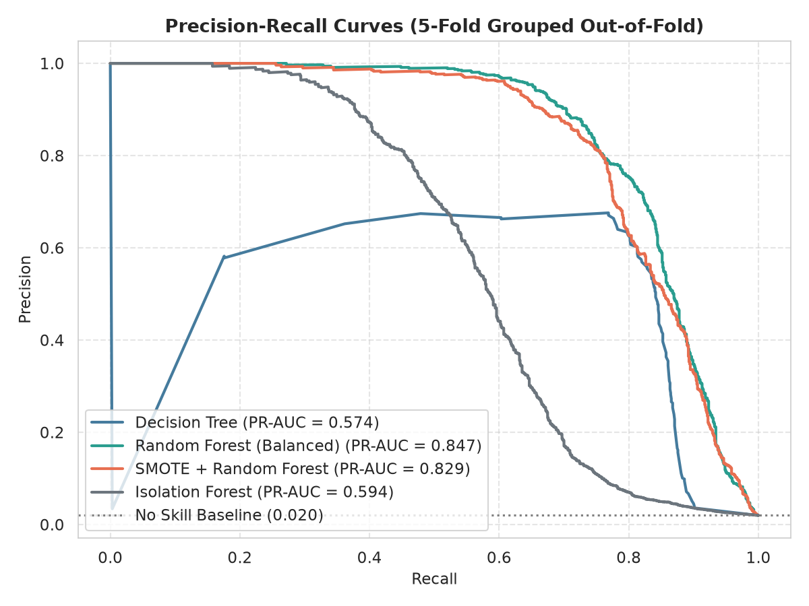
*Figure 9: Precision–Recall curves establishing Random Forest (Balanced) superiority over the 1.98% baseline.*

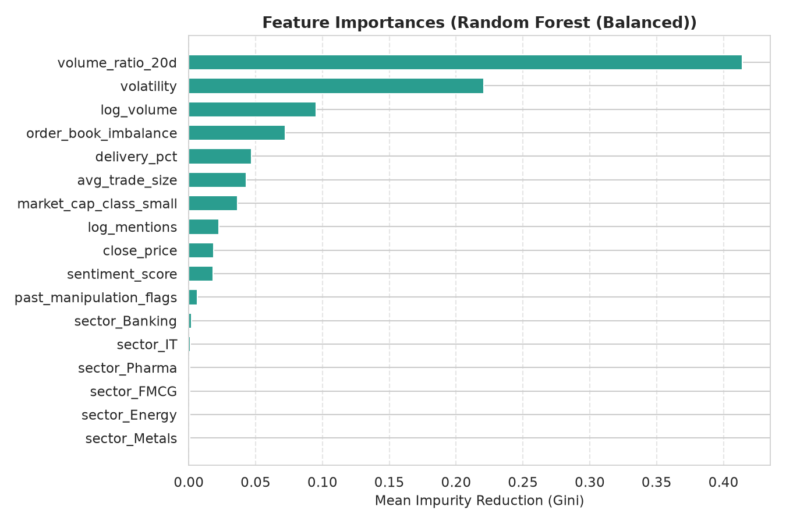
*Figure 10: Random Forest Gini feature importances.*

### 8.1 Optimal Alert Threshold Selection
Operating at the standard 0.50 threshold yields suboptimal balance on imbalanced datasets. Sweeping the Precision-Recall curve selected the threshold that maximizes the F1-Score:
- **Optimal Alert Threshold:** $\tau^* = \mathbf{0.7325}$
- **Operational Precision:** **87.9%** (Low false alarm burden for exchange officers)
- **Operational Recall:** **72.6%** (Detects &gt;7 out of 10 manipulation episodes early)
- **Operational F1-Score:** **0.795**

---

## 9. Full-Stack Implementation & System Deployment

### 9.1 Backend Architecture (FastAPI)
The backend service (`backend/main.py`) provides:
- Single-point model loading at module import, pre-loading pipelines and pre-computing stock statistics.
- Strict Pydantic v2 data validation with custom field validators for sector enums and market cap classes.
- Zero-leakage inference pipeline capable of handling missing numeric values via median imputation.
- Full test suite in `backend/tests/test_api.py` passing 13 integration tests.

### 9.2 Frontend Architecture (React + Vite + Tailwind + Recharts)
The modern single-page dashboard (`frontend/`) features:
1. **Live Scorer Dashboard:** Interactive slider form, preset buttons ("Load Normal Day", "Load Pump-Build-Up Day"), animated SVG Gauge, risk band badge, and linear coefficient feature contribution bar chart.
2. **Stock Explorer:** Searchable 200-stock directory, dual synchronized Recharts tracking actual vs predicted risk and close price vs volume ratio over 250 trading days.
3. **EDA Insights View:** Key metric cards, Welch t-test results, and high-resolution figure viewer.
4. **Model Performance Hub:** Model benchmarking table, CV fold charts, bias-variance analysis, and dynamic PDF comparison table.
5. **About Page:** Problem definition, Sadhna Broadcast case study, team roster, and academic limitations notice.

---

## 10. Conclusion & Future Work

### 10.1 Key Findings
1. **Early Warning Feasibility:** Pump-and-dump build-up leaves clear statistical signatures—namely volume expansion coupled with delivery decay and positive order book imbalance—allowing detection 10 to 15 days *before* the dump crash.
2. **Evaluation Rigor:** Grouped stock cross-validation avoids substantial optimistic bias; accuracy is an invalid metric under extreme 1.98% class imbalance, making PR-AUC and F1 threshold tuning essential.
3. **Model Selection:** Balanced Random Forest outperforms both standard Decision Trees and SMOTE over-sampling, achieving PR-AUC of **0.847**.

### 10.2 Future Extensions
- **Real NSE Bhavcopy Integration:** Ingest official daily delivery percentages and turnover reports from the National Stock Exchange of India.
- **SEBI Enforcement Graph Modeling:** Construct Graph Neural Networks (GNNs) linking suspicious trading accounts, common brokerages, and registered beneficial owners.
- **Real-Time NLP Sentiment Streams:** Process live Telegram and YouTube channel transcripts using lightweight fine-tuned financial transformer models.
